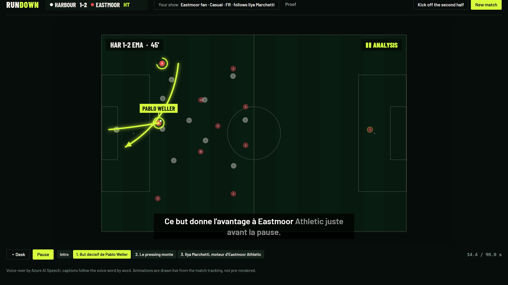
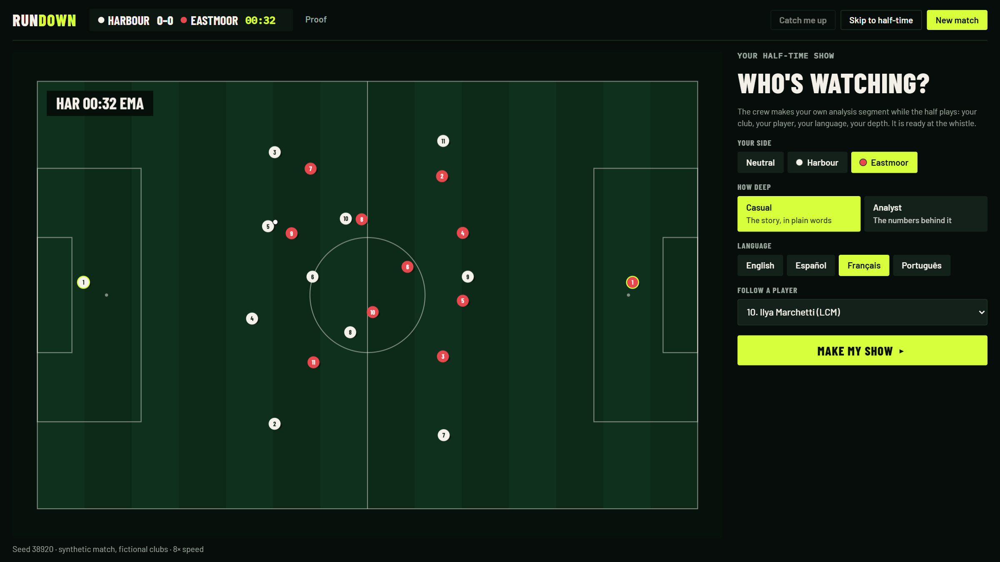
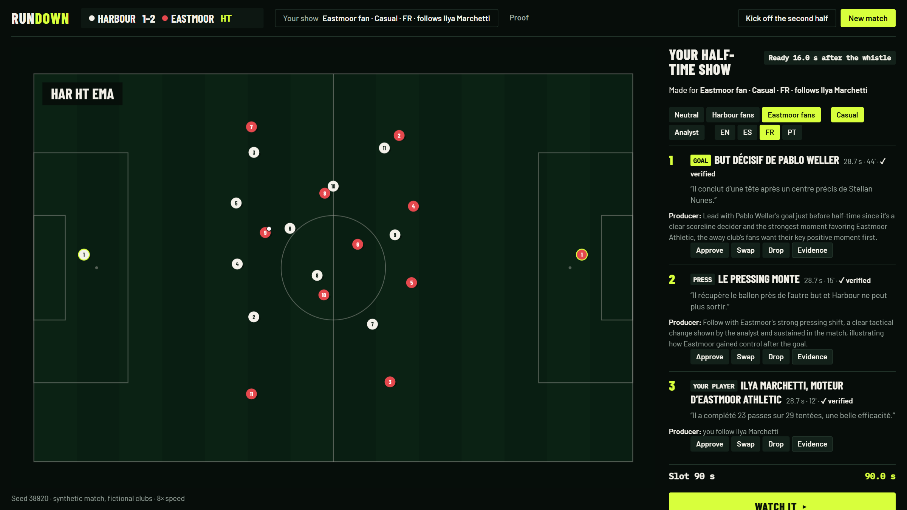
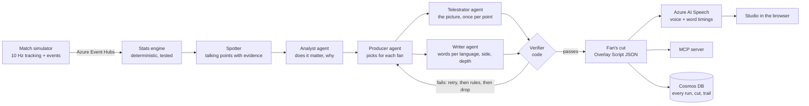
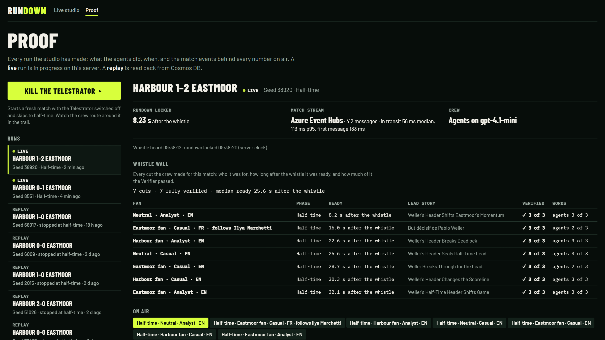

<p align="center">
  
</p>

<h1 align="center">Rundown For You</h1>

<p align="center">
  <b>Every fan's own half-time show, ready at the whistle.</b><br>
  A crew of agents makes a verified analysis segment for each fan: their club, their player, their language, their depth.
</p>

<p align="center">
  <a href="https://rundown.mangowave-7522f242.swedencentral.azurecontainerapps.io"></a>
  <a href="https://github.com/jenzylove/rundown/actions/workflows/ci.yml"></a>
  
  
  
  <a href="LICENSE"></a>
</p>

<p align="center">
  
  <br><sub>An Eastmoor fan's half-time show, in French: the move drawn from the tracking, the voice by Azure AI Speech, the captions following it word by word.</sub>
</p>

Half-time analysis is made once, for one market, in one language. A fan of the away side in
Lisbon, a casual viewer in Lyon and a data analyst in London all get the same three segments, or
none at all when their broadcaster takes the world feed.

Personalized shows exist, but they run once a day, and their scripts are still checked by people
before they go out ([ESPN on SportsCenter For You](https://www.espnfrontrow.com/2025/08/chris-fowler-us-open-sportscenter-for-you/)).
That is the real limit: **personalized sports shows don't have a writing problem, they have a
checking problem.** A machine checker that recomputes every claim before it airs is what makes a
live show for every fan possible.

Rundown For You watches a match as it streams, and in the minutes of the break makes each fan's own
segment: the stories that matter to their club, drawn on the pitch, voiced in their language, plain
for a casual fan or full of evidence for an analyst, with a segment on the player they follow. A
fan who joins late presses **Catch me up**. Nothing reaches a fan without passing the Verifier.

| | |
|---|---|
| Live app (no sign-up) | https://rundown.mangowave-7522f242.swedencentral.azurecontainerapps.io |
| Proof: every run, every cut, the trail, the evals | [`/proof`](https://rundown.mangowave-7522f242.swedencentral.azurecontainerapps.io/proof) |
| MCP server (streamable HTTP) | `https://rundown.mangowave-7522f242.swedencentral.azurecontainerapps.io/mcp/` |
| Evals, with every miss | [docs/EVALS.md](docs/EVALS.md) |
| Product requirements | [docs/PRD.md](docs/PRD.md) |

## For judges: five minutes, no keys

1. Open the [live app](https://rundown.mangowave-7522f242.swedencentral.azurecontainerapps.io). A fresh synthetic match is already playing.
2. **Who's watching?** Pick a side, Casual or Analyst, a language, and a player to follow. Press **Make my show**.
3. Press **Catch me up** after a few minutes of play: a short voiced segment on what you missed, for your profile.
4. Press **Skip to half-time**. Your show appears on the desk with its segments verified. Press **Watch it**.
5. Flip the desk to another fan (the other club, Analyst, English) and compare: a different lead, different words, different numbers.
6. Open **Proof**: the whistle wall shows every cut made this break, how many seconds after the whistle each was ready, and how much of it the Verifier passed.

<p align="center">
  
  
</p>

## How it works



- **Code computes every number; agents choose and explain.** The stats engine (pass difficulty,
  speeds, pressing, field tilt, tempo, a player's running) carries the event ids behind each value.
- **The crew hands off through one shared store per match**, and every write is recorded: who, what,
  why, which events. The trail is on `/proof` and archived in Cosmos DB.
- **The Telestrator's picture is made once per talking point** and shared by every fan's cut; the
  Writer writes per language, side and depth. The fans watching are drafted during the half and
  made first at the whistle, then a wall of cuts for every side at both depths.
- **The Verifier is the last gate**, for every segment of every cut: every fact recomputed, every
  event real, every number said is a value of the facts its line cites, every before and now the
  right way round (order, rise and fall words, time words, in four languages), and the depth the fan
  asked for. A segment that fails gets one retry with the errors, then the rules version, then is
  replaced or dropped. The trail shows which.
- **When an agent fails, the crew routes around it.** `/proof` has a button that switches the
  Telestrator off mid-match; the rundown still locks, verified, and the trail shows how.

## What it says, measured

Twelve held-out matches (seeds 101 to 112), eight fans each, the agent crew on gpt-4.1-mini.
Full method and every miss: [docs/EVALS.md](docs/EVALS.md).

| | Agent crew |
|---|---|
| Segments that passed the Verifier and aired | 274 of 274 |
| Casual and analyst scripts that differ | 36 of 36 |
| Home and away cuts that differ | 16 of 24 (the rules crew: 22 of 24) |
| Followed players with their own segment | 24 of 24 |
| Seconds to make one fan's cut after the whistle (median, worst) | 11.6 s, 20.3 s |
| Segments aired with the Writer agent's own words | 203 of 274 (74%) |

**Planted errors.** Every clean segment was copied with one error planted in what it says, and each
copy went through the Verifier as it was on 22 Oct and as it is now:

| Error planted | Copies | Caught on 22 Oct | Caught now |
|---|---|---|---|
| A number changed in a spoken line | 501 | 0% | 95% |
| A before and now pair quoted the wrong way round | 177 | 0% | 97% |
| A rise said as a fall, or a fall as a rise | 115 | 0% | 85% |
| A number changed on the stat card | 274 | 0% | 95% |

**Finding the story.** Each match plants tactical stories the agents never see. On the neutral
cut the agent crew put 19 of 33 on air against 17 for a rules-only picker, with 27 of 34 aired
points relevant against 25. Foundry's groundedness judge scored 32 of 34 agent scripts at 4 or 5.

Rerun any of it without keys: `python -m rundown.evals.fans --seeds 101-112 --rules-only`.

## The judging criteria

| Criterion | What is here |
|---|---|
| Technological Implementation | A match simulator with planted ground truth, a tested stats engine, a published [Overlay Script schema](schema/overlay-script.v1.json), a canvas renderer, Bicep and CI. Each Azure service does real work: Foundry (models and the groundedness judge), Agent Framework (the crew), AI Speech (voices and word timings in four languages), Event Hubs (the live match), Container Apps (the app and the burst at the whistle), Cosmos DB (every run, cut and trail), Application Insights (the crew's traces). |
| Agentic Design and Innovation | Analyst, Producer, Telestrator and Writer agents with distinct jobs, handing off through shared state, each output gated by a code Verifier; retries, routing around a failed agent, and a kill switch on `/proof`. One crew makes many different, verified cuts in the minutes of a break, and the same crew answers other agents over MCP. |
| Real-World Impact | Fans in any market get analysis made for them, live; a broadcaster keeps a master rundown with an approve, swap and drop desk and gets an Overlay Script a rendering partner could put on a real feed. It removes the human review step that keeps personalized shows daily. |
| User Experience | Pick a fan card in ten seconds, watch your own show at the whistle, flip to another fan, catch up any time. |
| Adherence to Category | Every stage of the brief: ingest, interpret, explain, render, personalize (side, player, language, casual or analyst). **Best Multi-Agent System:** distinct roles, shared state and handoffs, recovery from failure, and an outcome one agent could not produce as well in the time. |

## What is real

| Part | State |
|---|---|
| Clubs, players and matches | Synthetic and fictional, generated by the simulator; no real footage or league data |
| The live match stream | Real: Azure Event Hubs carries every match the app plays |
| The agents | Real calls to gpt-4.1-mini on Microsoft Foundry through Agent Framework |
| Voices and captions | Real Azure AI Speech, timed to the words |
| The Verifier | Code, in `rundown/agents/verify.py`, run on every segment before it airs |
| Archive and replays | Real Cosmos DB; `/proof` marks each run live or replay |
| MCP | Real server at `/mcp/`: `list_matches`, `get_match`, `get_fan_show`, `catch_me_up`, `whistle_wall` |

The renderer is a 2D pitch; the Overlay Script is the format a broadcast renderer would play. The
Verifier checks numbers, their order and their direction, not tone or colour; the Foundry judge
watches that.

## Run it

```bash
pip install -e ".[api,agents,azure,dev]"
cd web && npm ci && npm run build && cd ..
RUNDOWN_CREW=rules uvicorn rundown.api.app:app --port 8000     # no keys: the rules crew, local stream
python -m pytest -q                                            # about 8 minutes; tests/test_verify.py alone is quicker
```

With `AZURE_OPENAI_ENDPOINT`, `AZURE_OPENAI_API_KEY`, `AZURE_OPENAI_DEPLOYMENT` and
`AZURE_SPEECH_REGION` set, the agent crew and the voices switch on. Azure deploy: [docs/DEPLOY.md](docs/DEPLOY.md)
(`scripts/deploy.sh`, Bicep in `infra/`). More: [docs/CREW.md](docs/CREW.md),
[docs/SIMULATOR.md](docs/SIMULATOR.md), [docs/BUILD_LOG.md](docs/BUILD_LOG.md).

<p align="center">
  
</p>

Built for the Microsoft and Premier League *Inside the Game* Developer Hackathon. MIT licensed.
