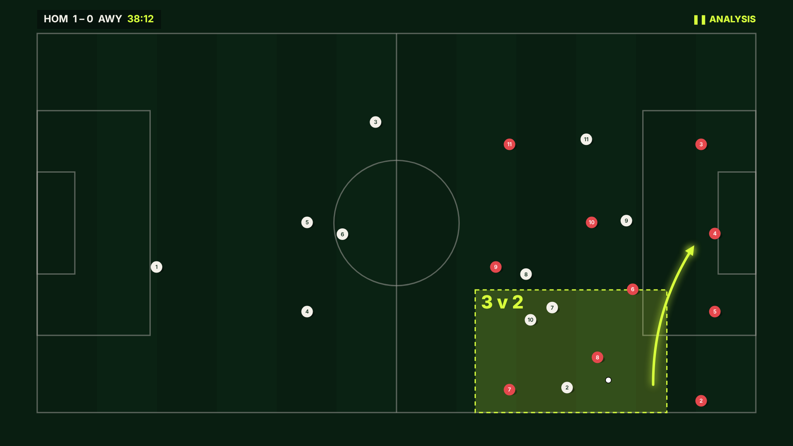
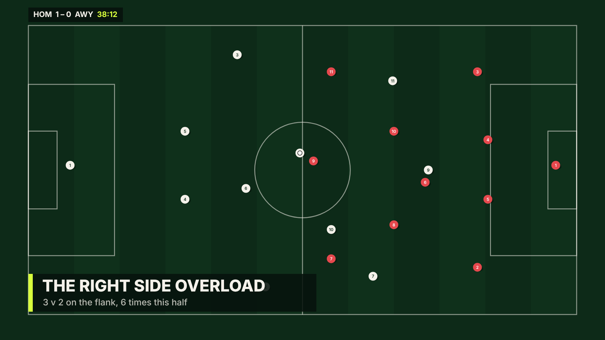

# Spike S1: telestration renderer

**Date:** 20 Oct 2026 · **Time box:** 90 min · **Code:** `spikes/s1-telestration/` (throwaway)

## Question
Can a browser renderer play a timed overlay script over 10 Hz synthetic tracking,
smoothly, and does it read like broadcast telestration?

## What was run
- A hand-built 14 s attacking move: 22 players plus the ball, sampled at 10 Hz and
  interpolated to render time. Scripted runs for the attackers; everyone else
  moves with a simple block-shift model.
- A 16 s overlay script with 11 cues across all the kinds planned for
  Overlay Script v1: `play`, `freeze`, `label`, `highlight`, `run`, `zone`, `arrow`
  (pass and cross), `statcard`.
- A Canvas 2D renderer with a deterministic `renderAt(t)`, for frame-exact export.
- Headless Chromium 1920×1080: live rAF pacing, then 480 frames exported at 30 fps,
  encoded to H.264 with ffmpeg.

## Output
```
live pacing {"frames":953,"p50":16.7,"p95":16.7}   # steady 60 fps
captured 480 frames in 50.4 s                        # export ≈ 3× real time, headless
segment.mp4  16.0 s  688 KB
```



## Verdict: **PASS**
The format and renderer work. Freezes, drawn-on arrows, dashed runs, pulsing zones,
player rings with name tags, lower thirds and stat cards all play from one timed
script, at a steady 60 fps. Deterministic export makes an MP4 download possible
without screen recording.

## What the build must change (found here)
1. **Overlay placement must avoid the action.** The lower third covered the
   overlapping full back, who was the subject of the story. The Telestrator or
   renderer needs collision-aware placement: never cover a highlighted player or
   the ball.
2. **The ball hid the player receiving it.** Draw the ball offset, or above with a
   ring, at the receiver's feet.
3. **Movement realism depends on the simulator, not the renderer.** The block-shift
   model makes off-ball players drift rigidly. The Phase 1 simulator needs role-based
   movement (support angles, defensive line, pressing triggers).
4. **The stat card numbers in this spike were typed by hand.** In the product, every
   number comes from the stats engine and passes the Verifier.
5. **Export speed:** about 3× real time headless via per-frame screenshots. That's
   fine for a 90 s segment (about 5 min). Use `canvas.captureStream` and
   MediaRecorder in the browser for faster client-side export.
